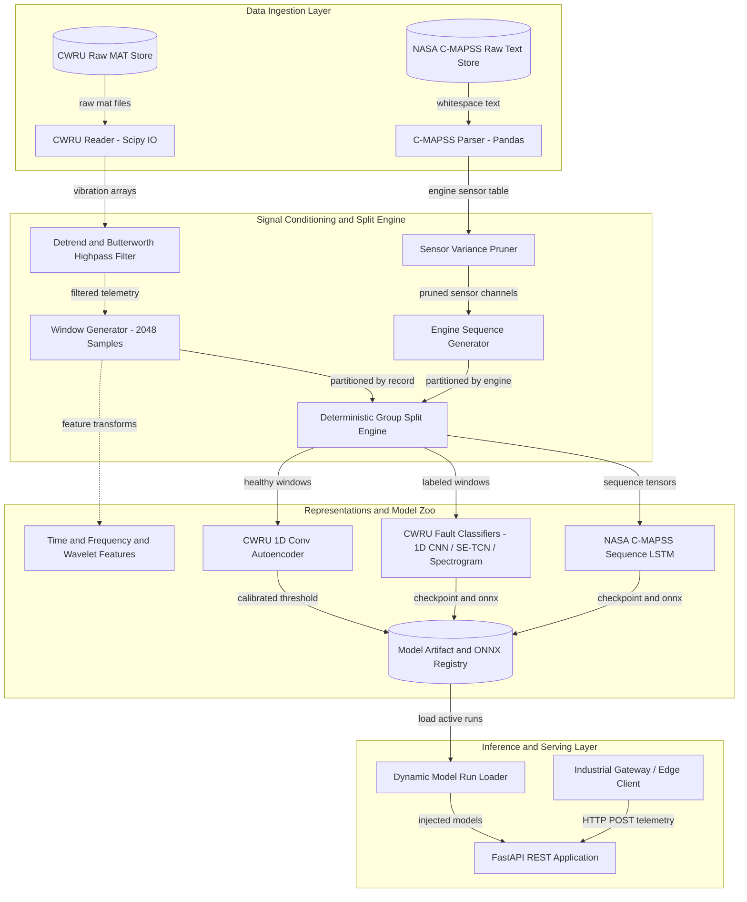
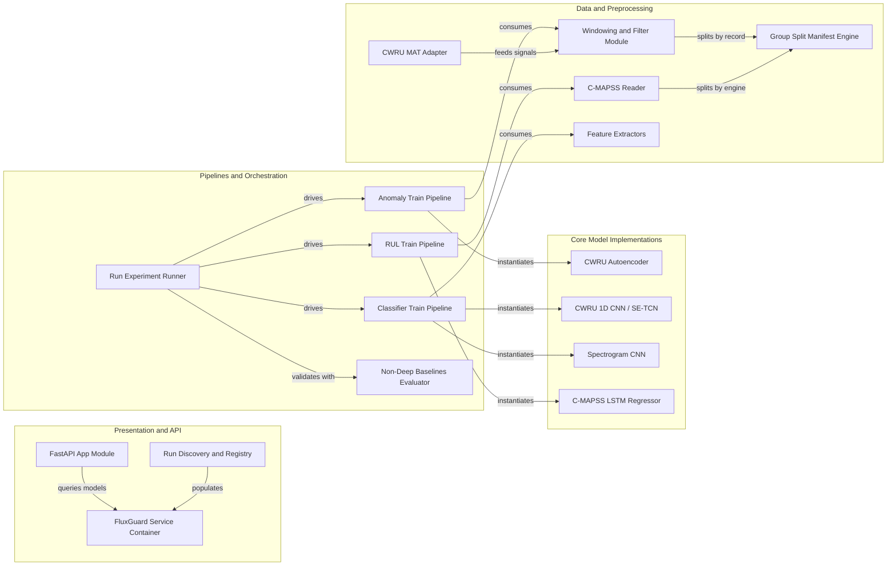

# Architecture Diagram

High-level architecture and component interaction model for FluxGuard AI, an industrial machine learning platform for predictive maintenance and condition monitoring.

## Application Architecture

<!-- mermaid-checked: no \n, no em-dash/en-dash, no {} in labels, subgraphs are id["label"], arrows are -->|"label"|, all subgraphs closed by end, ids unique -->

### Technology Stack Summary

| Layer | Technology | Version | Purpose |
|---|---|---|---|
| Deep Learning Framework | PyTorch | >=2.4 | Neural network architectures (Autoencoder, SE-TCN, 2D CNN, LSTM) |
| Signal Processing | SciPy (signal / io) | >=1.13 | Highpass Butterworth filtering, detrending, STFT, and MAT file ingestion |
| Wavelet Transforms | PyWavelets | >=1.6 | Continuous Wavelet Transform (CWT) scalogram generation |
| Data & Arrays | NumPy, pandas | >=1.26, >=2.2 | Ingestion, 26-column engine tables, matrix transformations |
| Classical ML & Metrics | scikit-learn | >=1.5 | Standard scaling, non-deep baselines, classification/regression metrics |
| Deployment & Hardware | ONNX, ONNX Runtime | >=1.16 | Dynamic-batch graph export and edge inference runtime |
| API Serving | FastAPI, Uvicorn | >=0.115, >=0.30 | High-performance asynchronous REST endpoints |
| Containerization | Docker | Python 3.12-slim | Lightweight portable production deployment container |

### Data Storage & External Services

FluxGuard AI operates primarily on local industrial data volumes and versioned disk registries. Raw vibration recordings (160 MAT files from CWRU) and multi-channel engine degradation logs (NASA C-MAPSS FD001-FD004) reside in the file system under `data/raw/`. Training pipelines persist fully self-contained artifact packages under `models/runs/<experiment>/<run-id>/`, containing PyTorch weights (`model.pt`), deployment graphs (`model.onnx`), schema descriptors (`config.json`), preprocessing statistics (`preprocessing.json`), cryptographic split manifests (`split-manifest.json`), and benchmark metrics (`metrics.json`). No external cloud database or broker is required for runtime operation, keeping the pipeline secure and air-gapped for edge industrial environments.

### Key Architectural Decisions

- **Strict Recording- and Engine-Level Disjoint Splitting**: CWRU is partitioned by physical recording ID and C-MAPSS is partitioned by engine ID, eliminating data leakage from overlapping temporal windows.
- **Unsupervised Zero-Shot Anomaly Calibration**: The 1D Convolutional Autoencoder is trained strictly on healthy baseline data, calibrating its threshold dynamically at `mu + 3 * sigma` on healthy validation errors.
- **ONNX Export and Dynamic Batch Validation**: Every model run exports and validates a standardized ONNX graph with dynamic batch axes for AMD Quark quantization and edge execution.

## Component Relationships

<!-- mermaid-checked: no \n, no em-dash/en-dash, no {} in labels, subgraphs are id["label"], arrows are -->|"label"|, all subgraphs closed by end, ids unique -->

### Component Inventory

| Component | Layer | Type | Responsibility |
|---|---|---|---|
| `FastAPI App Module` | Presentation | REST API Controller | Exposes `/health`, `/api/anomaly/score`, `/api/fault/predict`, and `/api/rul/predict` endpoints |
| `Run Discovery and Registry` | Presentation | Dynamic Factory | Scans `models/runs/`, verifies artifact bundles, and constructs live model runners |
| `FluxGuard Service Container` | Presentation | Service Registry | Holds instantiated models, calibrated anomaly thresholds, and class names |
| `Run Experiment Runner` | Pipeline | CLI Orchestrator | Automates end-to-end dataset loading, partitioning, baseline checking, training, evaluation, and ONNX export |
| `Anomaly Train Pipeline` | Pipeline | Training Module | Trains autoencoder on healthy windows and computes statistical anomaly thresholds |
| `Classifier Train Pipeline` | Pipeline | Training Module | Trains 1D CNN, SE-TCN, or Spectrogram CNN using class-weighted cross-entropy loss |
| `RUL Train Pipeline` | Pipeline | Training Module | Trains LSTM sequence regressor to predict Remaining Useful Life cycles on C-MAPSS |
| `Non-Deep Baselines Evaluator` | Pipeline | Validation Gate | Computes simple baselines (RMS energy, Majority Class, Linear Regression) before deep training |
| `CWRU Autoencoder` | Model Zoo | PyTorch Module | 1D Convolutional Autoencoder mapping healthy vibrations to a bottleneck latent space |
| `CWRU 1D CNN / SE-TCN` | Model Zoo | PyTorch Module | Dilated causal convs and Squeeze-and-Excitation attention for bearing fault classification |
| `Spectrogram CNN` | Model Zoo | PyTorch Module | 2D Convolutional network processing STFT spectrograms or CWT scalograms |
| `C-MAPSS LSTM Regressor` | Model Zoo | PyTorch Module | Recurrent LSTM network capturing multivariate degradation trajectories |
| `CWRU MAT Adapter` | Data Layer | Data Ingestion | Discovers, parses, and validates CWRU MATLAB files, extracting calibrated vibration channels |
| `C-MAPSS Reader` | Data Layer | Data Ingestion | Parses 26-column engine telemetry, enforces cycle monotonicity, and computes RUL ground truth |
| `Windowing and Filter Module` | Preprocessing | Signal Conditioning | Performs linear detrending, zero-phase Butterworth filtering, and overlapping sliding windowing |
| `Group Split Manifest Engine` | Preprocessing | Partition Gate | Generates deterministic, disjoint train/validation/test splits with SHA-256 integrity fingerprints |
| `Feature Extractors` | Preprocessing | Feature Engineering | Extracts time-domain statistics (RMS, kurtosis), FFT spectra, STFT spectrograms, and CWT scalograms |
