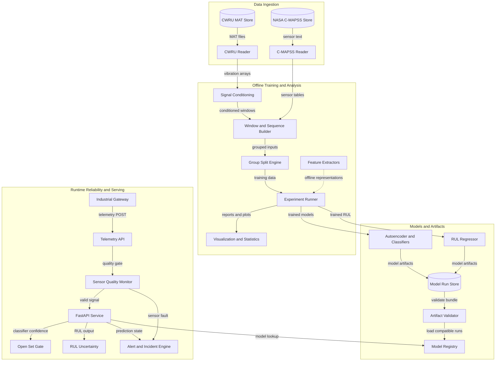
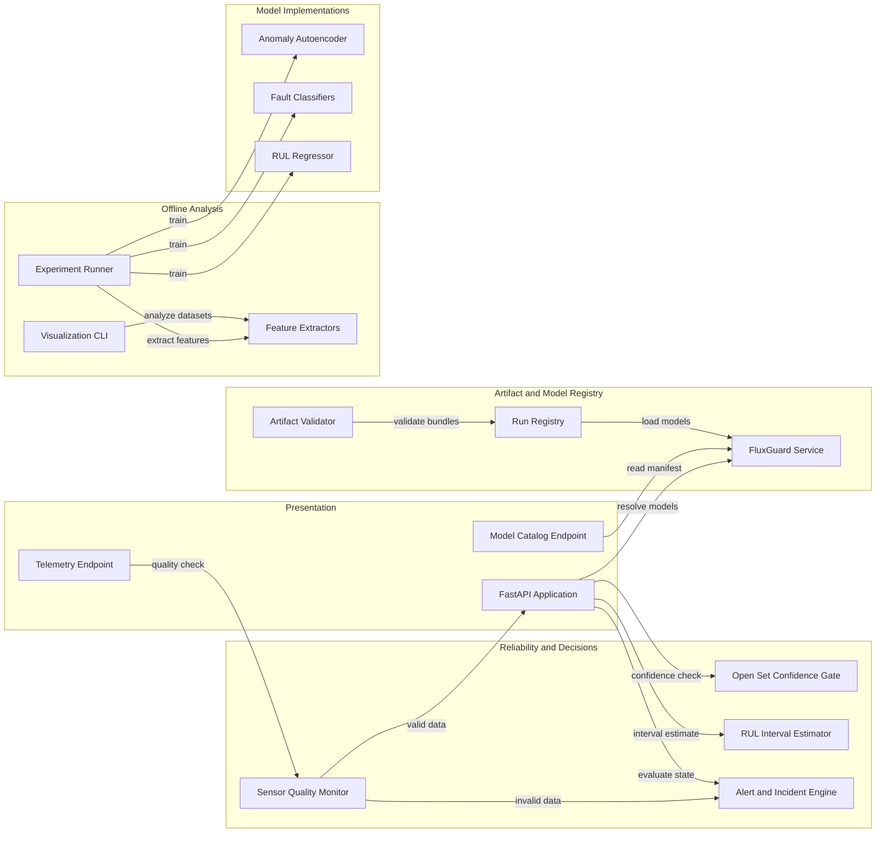

# Architecture Diagram

FluxGuard AI is a local-first predictive-maintenance platform. Offline
training and visualization produce versioned model artifacts, while the
FastAPI runtime applies sensor quality gates, model inference, and alert
decisions to incoming telemetry.

## Application Architecture

<!-- mermaid-checked: no \n, no em-dash/en-dash, no {} in labels, subgraphs are id["label"], arrows are -->|"label"|, all subgraphs closed by end, ids unique -->

### Technology Stack Summary

| Layer | Technology | Version | Purpose |
|---|---|---|---|
| Deep learning | PyTorch | >=2.4 | Autoencoder, CNN, SE-TCN, spectrogram CNN, and LSTM |
| Signal processing | SciPy | >=1.13 | MAT loading, detrending, filtering, FFT, and STFT |
| Wavelets | PyWavelets | >=1.6 | CWT scalogram generation |
| Data processing | NumPy and pandas | >=1.26 and >=2.2 | Dataset tables and tensor preparation |
| Classical ML | scikit-learn | >=1.5 | Scaling, baselines, and evaluation metrics |
| API serving | FastAPI and Uvicorn | >=0.115 and >=0.30 | Local inference and telemetry API |
| Graph export | ONNX and ONNXScript | >=1.16 and >=0.1 | Model export and graph validation |
| ONNX execution | ONNX Runtime | Optional | Numerical parity and edge latency checks |
| Visualization | Matplotlib | >=3.9 | Offline plots and statistical reports |

### Data Storage and External Services

The platform uses local file storage for raw datasets, generated reports, and
versioned model bundles under `models/runs/`. The artifact validator checks
required files and JSON metadata before the registry loads a run. There is no
database, message broker, cloud service, or external industrial protocol
adapter in the current runtime. MQTT, OPC UA, and Modbus remain integration
options for a future deployment boundary.

### Key Architectural Decisions

- CWRU splits are recording-aware and C-MAPSS splits are engine-aware to avoid
  leakage from overlapping windows and related sequences.
- Runtime telemetry passes through a sensor-quality gate before model scoring,
  and sensor faults take precedence over machine-fault alerts.
- The registry loads the newest complete compatible run while retaining all
  discovered runs in its manifest for inspection and rollback planning.
- RUL intervals and open-set rejection are baseline heuristics and are not
  presented as calibrated uncertainty or formal OOD detection.

## Component Relationships

<!-- mermaid-checked: no \n, no em-dash/en-dash, no {} in labels, subgraphs are id["label"], arrows are -->|"label"|, all subgraphs closed by end, ids unique -->

### Component Inventory

| Component | Layer | Type | Responsibility |
|---|---|---|---|
| FastAPI Application | Presentation | REST application | Exposes liveness, readiness, inference, telemetry, alert, and model routes |
| Telemetry Endpoint | Presentation | Ingestion route | Accepts vibration windows and sends them through quality and decision processing |
| Model Catalog Endpoint | Presentation | Catalog route | Reports loaded capabilities and discovered run manifests |
| Sensor Quality Monitor | Reliability | Quality gate | Detects invalid, flatline, stuck-at, and saturated telemetry |
| Open Set Confidence Gate | Reliability | Decision gate | Converts low-confidence classifier results to `UNKNOWN_FAULT` |
| RUL Interval Estimator | Reliability | Heuristic estimator | Adds lower and upper RUL bounds and a reliability flag |
| Alert and Incident Engine | Reliability | State machine | Applies persistence, recovery, deduplication, and sensor-fault precedence |
| Artifact Validator | Registry | Validation service | Checks required run files and readable metadata before loading |
| Run Registry | Registry | Dynamic loader | Selects newest complete runs and retains discovered manifests |
| FluxGuard Service | Registry | Runtime container | Holds models, thresholds, class names, and alert state |
| Experiment Runner | Offline | CLI orchestrator | Trains, evaluates, exports, and reports model runs |
| Visualization CLI | Offline | Analysis tool | Produces multi-domain plots, trajectories, and summary statistics |
| Feature Extractors | Offline | Signal processing | Computes time, FFT, STFT, and CWT representations |
| Anomaly Autoencoder | Models | Neural model | Detects deviations from healthy vibration patterns |
| Fault Classifiers | Models | Neural models | Classifies known bearing fault categories |
| RUL Regressor | Models | Sequence model | Estimates remaining useful life from C-MAPSS sequences |

## Current Operational Boundaries

- Incidents and prediction state are in process memory and are not durable.
- The API has no authentication, authorization, rate limiting, or audit store.
- ONNX Runtime is optional; parity is reported as `skipped` when unavailable.
- RUL intervals use a heuristic margin and require later calibration.
- Open-set behavior uses a confidence threshold and is not formal OOD detection.
- External telemetry adapters and production observability are not included.
